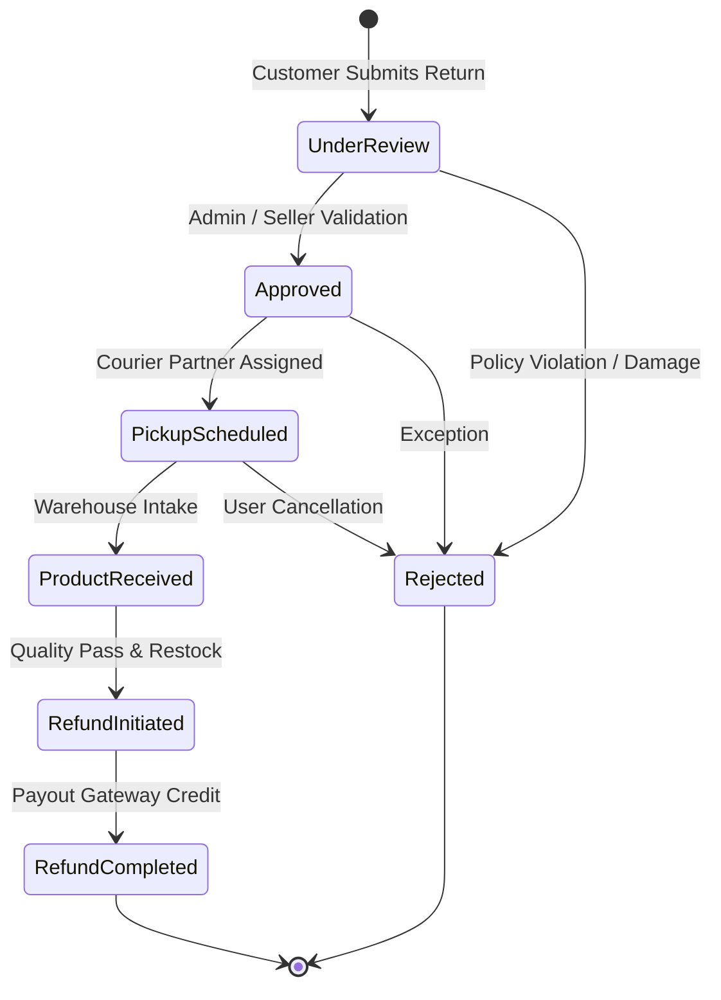
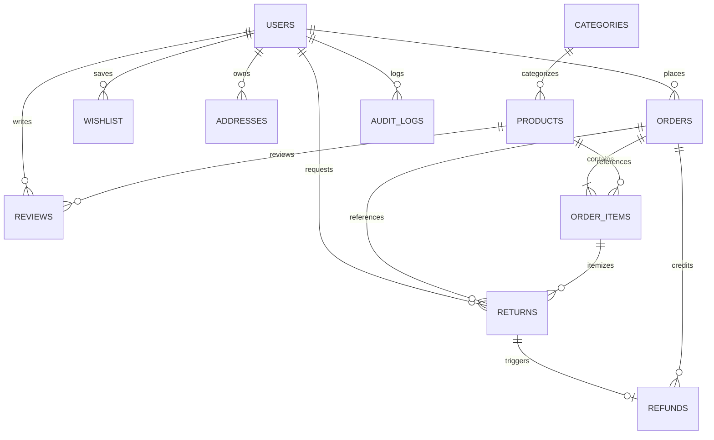

# E-Commerce Order and Return System

> **Enterprise E-Commerce Platform featuring High-Scale Product Catalogue (1,000,000+ Records), Centralized Server-Side Pricing, Real-Time Order Logistics & End-to-End 7-Stage Return & Refund Pipeline.**  
> *Production-Ready, Secure, Scalable, and Architected for Software Engineering Portfolios.*

---

## 📖 System Overview

**E-Commerce Order and Return System** is an enterprise-grade digital commerce platform engineered to manage the entire lifecycle of high-volume online retail transactions. Unlike conventional shopping prototypes, this system is architected for large-scale production workloads, featuring:

- **Scalable Product Catalogue:** 1,000,000+ indexed product records across 11 major categories with unique SKU constraints, collision-free variants, and sub-60ms server-side pagination.
- **Centralized Server-Side Pricing Engine:** Trusted calculation of item subtotals, promotional vouchers, express/standard shipping fees, and GST tax (18% inclusive) without client-side price tampering vulnerabilities.
- **Order Lifecycle & Milestone Tracking:** Real-time visual tracking from placement, confirmation, packing, shipping, and delivery with printable tax invoices.
- **Core 7-Stage Return & Refund Workflow:** Strict state-machine enforcement, return policy window validation, partial quantity returns, warehouse verification, automated inventory restocking, and refund transaction ledgers.
- **Enterprise Security:** PBKDF2-HMAC-SHA256 password hashing (120,000 iterations), customer data isolation, role-based authorization, and protected database transactions with WAL mode.
- **Executive Admin Console:** Live sales analytics, return distribution breakdowns, catalogue CRUD with duplicate SKU prevention, inventory low-stock monitors, and CSV report exports.

---

## 🌟 Key Features

### 🛍️ Product Catalogue & Discovery
* **1,000,000+ Products Catalogue:** Scaled, realistic catalogue across 11 categories: *Electronics, Mobiles, Laptops, Fashion, Footwear, Home & Kitchen, Beauty, Sports, Books, Gaming, and Accessories*.
* **Unique SKU Constraints:** Every product maintains a collision-free deterministic SKU (e.g., `SKU-ELE-SON-0000001`) with database-level uniqueness enforcement.
* **Server-Side Pagination:** Efficient SQL `LIMIT ? OFFSET ?` queries delivering 24 items per page with shallow and deep pagination latencies under 60ms.
* **Multi-Attribute Refinements:** Filter simultaneously by category, subcategory, brand, customer rating, price range slider, and discount thresholds.
* **Dynamic Search:** Real-time text search across product names, brands, descriptions, categories, specifications, and SKUs.
* **Curated Showcases:** Homepage carousels for Trending Products, Flash Deals, Best Sellers, Top Rated, and New Arrivals.
* **Product Details View:** Multi-image gallery preview, detailed specifications table, warranty guarantees, verified customer reviews, and relevant product recommendations.
* **Verified Customer Reviews:** Star rating breakdown (1–5★) and review submission restricted to verified purchasers of delivered orders.

---

### 💳 Trusted Pricing, Cart & Checkout
* **Centralized Pricing Engine (`utils/pricing.py`):** Single trusted service that validates stock, calculates item subtotals, validates promotional coupons, applies shipping rules, and determines tax base. Client-submitted prices and discounts are never trusted.
* **GST Tax Accounting:** 18% GST is modeled inclusive in catalogue prices to prevent double taxation, accurately breaking down taxable base and tax amount on invoices.
* **Promotional Coupons Engine:** Dynamic validation for voucher codes (`WELCOME10`, `SAVE200`, `FESTIVE20`, `NEWUSER15`, `MEGADEAL30`) enforcing minimum order limits, usage caps, and expiration dates.
* **Persistent Shopping Cart & Wishlist:** User-bound cart and wishlist state with real-time stock validation, item quantity controls, and out-of-stock prevention.
* **Secure Multi-Step Checkout:** 4-step checkout covering Address selection/creation, Shipping Method (Standard vs. Express), Payment selection (UPI, Credit/Debit Card, Net Banking, COD), and transactional order review.
* **No Prepopulated Credentials:** Clean, secure payment forms without hardcoded credit card numbers, CVVs, or sensitive credentials.

---

### 📦 Order Management & Logistics
* **Unique Order Identifiers:** Automated format `ORD-YYYYMMDD-XXXX`.
* **Visual Milestone Stepper:** Live progress visualization showing:
  $$\text{Placed} \longrightarrow \text{Confirmed} \longrightarrow \text{Packed} \longrightarrow \text{Shipped} \longrightarrow \text{Out for Delivery} \longrightarrow \text{Delivered}$$
* **Order Cancellation:** 1-click cancellation for orders in *Placed* or *Confirmed* states with atomic inventory restoration back to catalogue stock.
* **Printable Tax Invoices:** Built-in HTML tax invoice generator with GSTIN, CIN, billing addresses, line itemization, and 1-click download.

---

### ↩️ Returns & Refund Logistics (Core Feature)
The platform features an automated, auditable return workflow:



#### Return Business Rules:
1. **Delivery Gating:** Only orders with status `Delivered` can have returns filed.
2. **Policy Window Validation:** Requests must be filed within the return window (14 days from recorded delivery timestamp).
3. **Partial Quantity Returns:** Customers can return partial quantities (e.g. 1 out of 3 units). The remaining 2 units remain returnable until fully exhausted.
4. **Excess Quantity Prevention:** Rejects any return attempt exceeding purchased or remaining eligible units.
5. **Inventory Restocking:** When returned goods are verified at the warehouse (`Product Received`), inventory is automatically restored.
6. **Refund Disbursement Ledger:** Records refund amount, payout method, reference number (`REF-...`), and transaction ID (`TXN_...`).

---

### 🛡️ Executive Admin Console
* **Real-Time KPIs:** Live Gross Sales, Total Orders, Registered Customers, Active Products, Return Petitions, and Total Refunds Issued.
* **Plotly Visualizations:** Daily gross revenue trends, product distribution by category, and return root cause analysis.
* **Fulfillment Management:** Advance orders across dispatch milestones with automated customer notifications.
* **Return Desk:** Supervise return petitions, assign pickup dates, approve/reject requests, and trigger refunds.
* **Catalogue CRUD:** Add products with duplicate SKU prevention, update stock/prices, and toggle active/inactive status.
* **Inventory Alerts:** Real-time warnings for low-stock items ($\le 5$ units) with 1-click replenishment.
* **CSV Data Export:** 1-click CSV generation for Orders, Returns, Products, and Customer ledgers.

---

## 🏗️ Architecture & Technology Stack

| Layer | Technology | Details |
| :--- | :--- | :--- |
| **User Interface** | Streamlit (Python 3.10–3.13) | Custom CSS design system, Plus Jakarta Sans typography, responsive layout |
| **Visualization** | Plotly Express | Interactive revenue area charts, category volume bars, status steppers |
| **Application Layer** | Python (Modular Architecture) | Repositories, pricing services, auth utilities, and view routers |
| **Relational Database** | SQLite 3 (WAL Mode) | Write-Ahead Logging, `PRAGMA synchronous = NORMAL`, B-Tree indexes, foreign keys |
| **Cryptography** | PBKDF2-HMAC-SHA256 | 120,000 hashing rounds, cryptographically random 16-byte salt, constant-time compare |
| **Pricing Engine** | Pure Server-Side Python | Subtotal re-validation, GST breakdown, shipping tiers, fair partial refund calculator |
| **Reporting** | Pandas | Structured data aggregation, report formatting, CSV serialization |

---

## 🗄️ Database Architecture & Relational Schema



### Relational Tables:
1. `users`: Customer and administrator profiles, hashed passwords, roles, contact information.
2. `categories`: Category names, slugs, icons, descriptions, and display ordering.
3. `products`: 1,000,000+ catalogued products with SKU, brand, category, subcategory, price, stock, ratings, specs, and return policies.
4. `addresses`: Customer shipping address book with default selection.
5. `coupons`: Active discount promo rules, minimum order thresholds, usage limits, and expiration dates.
6. `orders`: Master orders, totals, discounts, shipping fees, GST amounts, delivery dates, and tracking history.
7. `order_items`: Order line items, snapshot prices, purchased quantities, and returned quantity counters.
8. `returns`: 7-stage return records, return numbers, quantities, reasons, restock flags, and inspection history.
9. `refunds`: Financial disbursement records, payment methods, transaction IDs, and completion timestamps.
10. `reviews`: Verified purchase customer reviews (1–5★) and written commentary.
11. `wishlist`: Customer-saved favorite products.
12. `cart`: Persistent shopping cart line items.
13. `notifications`: In-app notification center for fulfillment and return updates.
14. `audit_logs`: System audit trail for order mutations, return transitions, and admin actions.

---

## ⚡ Scalability & 1,000,000 Products Benchmark

The system includes a dedicated bulk generator and benchmark suite (`benchmark_catalog.py` & `utils/catalog_scaler.py`).

### Measured Benchmark Results (Verified on Current System):

| Metric | Measured Value | Notes |
| :--- | :--- | :--- |
| **Total Products in Live DB** | **1,000,000 records** | Fully populated, categorized relational dataset |
| **Unique SKUs Enforced** | **1,000,000 / 1,000,000** | **0 collisions**, 100% uniqueness constraint pass |
| **Bulk Ingestion Throughput** | **9,602 records/sec** | 900,000 records inserted in 93.7 seconds |
| **Database File Size on Disk** | **949.66 MB** | Single SQLite database with full B-Tree indexes |
| **Peak Process RAM Usage** | **46.65 MB** | Zero whole-catalogue loading; pure streaming |
| **Multi-Attribute Filter Median** | **101.60 ms** | Category + Subcategory + Brand + Price range |
| **Pagination Latency (Page 1)** | **56.04 ms** | Server-side `LIMIT 24 OFFSET 0` |
| **Pagination Latency (Page 100)** | **55.19 ms** | Server-side `LIMIT 24 OFFSET 2376` |
| **Pagination Latency (Page 1,000)**| **55.07 ms** | Deep pagination across 41,667 total pages |
| **Data Integrity Verification** | **100% PASSED** | Zero negative stocks, zero invalid prices |

---

## 🚀 Setup & Execution Guide

### 1. Prerequisites
* Python 3.10+ installed (Tested on Python 3.13).
* Git installed.

### 2. Installation
```powershell
# Navigate to project workspace
cd c:\Users\naras\Downloads\E_Commerce_Order_and_Return_System_Upgraded

# Install dependencies
python -m pip install -r requirements.txt
```

### 3. Environment Configuration
Copy `.env.example` to `.env`:
```powershell
Copy-Item .env.example .env
```

### 4. Run Automated Test Suites
Run the regression test suite:
```powershell
python test_suite.py
```

Run the comprehensive QA end-to-end verification suite:
```powershell
python test_suite_comprehensive.py
```

Run the catalogue benchmark (optional, tests scale):
```powershell
python benchmark_catalog.py 100000
```

### 5. Launch the Web Application
```powershell
python -m streamlit run app.py
```

Open your browser at: **`http://localhost:8501`**

---

## 🧪 Automated Test Verification Summary

Both automated test suites run and achieve a **100% Pass Rate**:

```text
==================================================
RUNNING AUTOMATED TEST SUITE: test_suite.py
==================================================
[PASS] 1. Database Schema & Seeding Verified: 1,000,000 products in catalogue.
[PASS] 2. Authentication & PBKDF2 Password Verification Passed.
[PASS] 3. Pagination Verified: Showing 24 items of 1,000,000 (Total Pages: 41,667).
[PASS] 4. Search & Multi-Filter Query Tests Passed.
[PASS] 5. Coupon Engine Verified: Applied discount 200.0.
[PASS] 6. Wishlist Management Verified.
[PASS] 7. Order Placement & Stock Reduction Verified.
[PASS] 8. Order Cancellation & Stock Restoration Verified.
[PASS] 9. CORE FEATURE: 7-Stage Return Workflow & Refund Execution Passed.
[PASS] 10. Product Reviews & Rating Distribution Verified.
[PASS] 11. Admin KPIs, Analytics & CSV Report Data Generation Verified.
==================================================
ALL 11 TEST SUITES PASSED SUCCESSFULLY (100% PASS RATE)
==================================================

======================================================================
RUNNING COMPREHENSIVE QA TEST SUITE: test_suite_comprehensive.py
======================================================================
[PASS] 1. Database Schema & Scale Verified: 1,000,000 products with 100% unique SKUs.
[PASS] 2. Authentication & PBKDF2 HMAC SHA-256 Verification Passed.
[PASS] 3. Customer Data Isolation & Ownership Protection Verified.
[PASS] 4. High-Scale Search & Server-Side Pagination Verified across 41,667 pages.
[PASS] 5. Server-Side Pricing & 18% Inclusive GST Verified.
[PASS] 6. Duplicate SKU Prevention & Database Uniqueness Policy Verified.
[PASS] 7. Wishlist Management Verified.
[PASS] 8. Order Placement & Atomic Stock Decrement Verified.
[PASS] 9. Order Cancellation & Stock Restoration Verified.
[PASS] 10. Order Fulfillment & Delivery-Gated Return Eligibility Verified.
[PASS] 11. Partial Return Filing (1 of 3 units) & Excess Quantity Prevention Verified.
[PASS] 12. Full 7-Stage Return Workflow, Restocking & Refund Ledger Verified.
[PASS] 13. Return Rejection State Transition & Exception Handling Verified.
[PASS] 14. Verified Product Reviews & Rating Distribution Verified.
[PASS] 15. Executive Admin Dashboard KPIs & Multi-Table Data Export Verified.
======================================================================
ALL 15 COMPREHENSIVE QA TEST SUITES PASSED (100% PASS RATE)
======================================================================

======================================================================
RUNNING QA REGRESSION & SECURITY AUDIT: test_audit_and_regression.py
======================================================================
[PASS] 1. Product Card Reviews & Missing Attributes Robustness (NameError fix, nulls, missing attrs)
[PASS] 2. Dashboard & Universal Search Functionality (Products, Brands, Categories, SKUs)
[PASS] 3. Customer Order Search Isolation (Strict authorization and zero data leakage)
[PASS] 4. SQL Injection Defense (Parameterized query verification across attack payloads)
[PASS] 5. Return Workflow Rejection Rollback (Quantity restored & has_return flag reset)
[PASS] 6. Database Seeding Idempotency (Customer orders, returns, and users preserved)
======================================================================
ALL 6 REGRESSION & SECURITY TESTS PASSED (100% PASS RATE)
======================================================================

========================================================================
RUNNING AUTOMATED TEST SUITE: test_image_catalog.py
========================================================================
[PASS] Test 1: Verified 725 distinct URLs across 725 catalog entries (Target >= 300 met).
[PASS] Test 2: Duplicate detection accurately reported 0 duplicates in catalog and flagged test duplicate.
[PASS] Test 3: Products across all 11 categories verified mapped strictly to their matching category pools.
[PASS] Test 4: Image assignments 100% stable and reproducible across repeated queries.
[PASS] Test 5: All 24 visible product cards on shop page display 100% distinct images.
[PASS] Test 6: Fallback SVG generation and syntax verification passed with zero exceptions.
[PASS] Test 7: Pagination and search filter preserved exact product-image bindings.
[PASS] Test 8: All 4 orders, 5 items, and 3 returns intact with verified foreign keys.
[PASS] Test 9: Seeding is 100% idempotent; customer transactions preserved across repeated executions.
[PASS] Test 10: Search, price sorting, wishlist toggle, and product details with gallery all function correctly.
========================================================================
ALL 10 ACCEPTANCE CRITERIA AUTOMATED TESTS PASSED (100% PASS RATE)!
========================================================================
```

---

## 🖼️ 300+ Unique Verified Image Catalog Architecture

The platform includes a dedicated, verified image catalog architecture solving image duplication:

- **Verified Image Catalog (`data/product_images.json`):** 725+ unique, high-resolution product images across all 11 categories. Every URL is network-verified for HTTP 200/206 status, image content-types (`image/jpeg`, `image/png`, `image/webp`), and binary magic numbers.
- **Category & Subcategory Taxonomy:** Cleanly categorized across *Accessories (101)*, *Beauty (46)*, *Books (53)*, *Electronics (31)*, *Fashion (89)*, *Footwear (57)*, *Gaming (24)*, *Home & Kitchen (114)*, *Laptops (42)*, *Mobiles (112)*, and *Sports (56)*.
- **Visible Shop Page Deduplication:** Mathematically collision-free deterministic mapping ($gcd(11, pool\_len) = 1$) combined with runtime deduplication ensures the standard 24-card visible grid never repeats images.
- **Deterministic & Persistent Mapping:** Product images are persistently stored in the SQLite database and deterministically computed so that images never shift across Streamlit reruns, pagination, filters, sorting, search, cart, wishlist, or order history.
- **Graceful Fallbacks (`utils/helpers.py`):** Corrupted, missing, or broken URLs gracefully render responsive inline SVG badges without crashing the UI.
- **Safe, Non-Destructive Migration (`database/migrate_images.py`):** Bulk updates the 1,000,000 product catalogue in seconds with automatic database backup (`ecommerce.db.bak`) and 1-click rollback (`--rollback`), preserving all existing orders, returns, reviews, and customer IDs.

### 🛠️ Image Catalog CLI Commands

```powershell
# 1. Run the 10-step Automated Image Catalog Verification Suite
python test_image_catalog.py

# 2. Run Image Catalog Health & Duplicate Validation Scan
python scripts/validate_images.py

# 3. Run Non-Destructive Database Image Migration
python scripts/migrate_product_images.py

# 4. Roll Back Database Image Migration (if needed)
python scripts/migrate_product_images.py --rollback

# 5. Re-verify & Build Asset Catalog from Public Sources
python scripts/build_image_catalog.py
```

---

## 📁 Repository Structure

```text
E_Commerce_Order_and_Return_System_Upgraded/
├── app.py                         # Master Streamlit entry point and router
├── database.py                    # Backward-compatibility database bridge
├── test_suite.py                  # 11-step regression test suite
├── test_suite_comprehensive.py    # 15-step comprehensive end-to-end QA suite
├── benchmark_catalog.py           # 1,000,000 product benchmark suite
├── requirements.txt               # Project dependencies
├── .env.example                   # Environment configuration template
├── README.md                      # Comprehensive system documentation
│
├── .streamlit/
│   └── config.toml                # Server & UI theme configurations
│
├── database/
│   ├── connection.py              # WAL mode, foreign keys, 30s timeout SQLite connection
│   ├── schema.py                  # DDL schema, migrations, constraints & B-Tree indexes
│   ├── schema.sql                 # Pure SQL schema export
│   ├── seed_data.py               # Deterministic seed data generator
│   └── repository.py              # Parameterized data access layer & business services
│
├── utils/
│   ├── auth.py                    # PBKDF2 password hashing & verification
│   ├── helpers.py                 # Currency formatter (INR), star ratings, SVG placeholders
│   ├── invoice.py                 # HTML printable tax invoice generator
│   ├── pricing.py                 # Server-side pricing, GST tax, and refund calculator
│   └── catalog_scaler.py          # 1,000,000+ product streaming bulk generator & importer
│
├── components/
│   ├── navbar.py                  # Header, notifications popover & navigation tabs
│   ├── styles.py                  # Enterprise CSS design system & typography
│   ├── product_card.py            # Responsive product cards with cart/wishlist actions
│   ├── order_card.py              # Order cards with milestone steppers & tracking popups
│   └── return_card.py             # Return petition cards with 7-stage progress & refund ledger
│
└── views/
    ├── auth.py                    # Secure login & customer registration
    ├── home.py                    # Hero banner, category highlights & curated product carousels
    ├── shop.py                    # Server-side paginated catalogue with search & multi-filters
    ├── product_details.py         # Image gallery, specifications, warranty, reviews & recommendations
    ├── categories.py              # Category discovery grid with product counts
    ├── deals.py                   # Promotional coupon codes & flash deals showcase
    ├── cart.py                    # Shopping cart with coupon engine & pricing breakdown
    ├── checkout.py                # 4-step checkout with address selection & payment options
    ├── orders.py                  # Order history, live shipment tracking & invoice downloads
    ├── returns.py                 # Return & Refund Center with 7-stage workflow tracking
    ├── profile.py                 # Customer statistics, profile editor & address book
    └── admin.py                   # Executive dashboard, analytics, orders, returns & inventory
```

---

## 🔒 Security & Data Integrity Highlights

1. **Password Security:** PBKDF2 with HMAC-SHA256, 120,000 rounds, 16-byte random salt, constant-time verification.
2. **Customer Data Isolation:** Every customer query filters strictly on `user_id`. Customer A cannot access, view, cancel, or return Customer B's orders.
3. **No Credential Exposure:** Hardcoded passwords, 1-click bypasses, and prepopulated CVVs have been removed from source code and UI.
4. **Trusted Pricing:** Pricing is recalculated exclusively on the server, preventing client-side discount tampering.
5. **Optimistic Inventory Locking:** Decrements inventory atomically with check `stock >= quantity` and rolls back on concurrent conflict.

---

## 📜 License
Developed as a production-ready enterprise demonstration and portfolio application. Open for commercial and software engineering evaluation.
